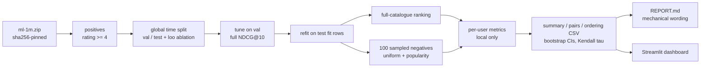

# recsys-ranking

> Which recommender should a team ship, and would the usual shortcut for evaluating it have
> picked a different one? Six models on MovieLens 1M under a global-time split, ranked against the
> full catalogue and against 100 sampled negatives, with a pre-registered rule for what counts as a
> reversal.

[](https://github.com/Prithv122/recsys-ranking/actions/workflows/ci.yml)

**Live demo:** not deployed — the Streamlit dashboard runs locally over the committed results.
**Stack:** Python 3.12 · numpy/scipy (own iALS, BPR-MF, item-kNN) · torch (optional two-tower) · Streamlit + Altair

---

## 1. The problem

A product team choosing between recommenders needs the offline ranking of models to match the order
they would see if users were shown the whole catalogue. Many papers and tutorials instead rank each
held-out item against 100 randomly sampled items, which is ~37× cheaper on this catalogue but can
reorder models. Picking the wrong model from a cheap metric ships the wrong recommender. This
project measures, on one public dataset, whether that shortcut changes the decision.

## 2. The data

| | |
|---|---|
| Source | [MovieLens 1M](https://grouplens.org/datasets/movielens/1m/), GroupLens Research (Harper & Konstan, 2015) |
| Size | 1,000,209 ratings, 6,040 users, 3,706 movies, 2000–2003; 575,281 positives (rating ≥ 4) |
| Licence | Research use; **no redistribution** without GroupLens permission. Downloaded by script, hash-pinned, git-ignored; only aggregate metrics are committed |
| Refresh | One-off (the archive is frozen) |

CI never sees the real data: tests use a seeded latent-factor generator (`synth.py`) and a
hand-written 52-line fixture in ML-1M format.

## 3. Architecture



Models: random, popularity, item-kNN (shrunk cosine), implicit ALS (Hu–Koren–Volinsky), BPR-MF, and
a two-tower network with in-batch negatives and logQ correction. All but the two-tower are numpy/scipy
code written here.

## 4. Key decisions & tradeoffs

| Decision | Chose | Over | Why |
|---|---|---|---|
| Split | One global time cutoff (headline) | Per-user leave-last-out | Leave-last-out trains on events that happen after other users' test events; it is kept as the ablation and its leak is measured |
| Negatives | Drawn once per fold and seed, shared by every model | Fresh draws per model | The comparison under study is between models; different negatives would add noise to exactly that |
| Tie rule in the sampled protocol | Ties count against the positive | Optimistic or mid-rank ties | A constant-score model must not look good; on this data mid-rank ties change popularity's sampled NDCG@10 by at most 0.0002 |
| What is a "reversal" | Both pairwise CIs exclude 0, in opposite directions (pre-registered) | Any swap in point estimates | Five or six models give a coarse tau; one noisy swap of two indistinguishable models is not a reversal |
| Tuning | Grid on the validation fold only, then one test-fold score per model, enforced in code | Tuning on test | The harness refuses to re-score a model already scored on the test fold |
| Published artefacts | Aggregate CSVs only | Per-user metrics | MovieLens terms forbid redistribution; per-user rows are a derivative |
| Models | Own numpy iALS/BPR | `implicit` library | The equations are the point; ALS is checked against a dense textbook solve in the tests |

## 5. Results

All numbers: MovieLens 1M, one global time split (test = the last 10% of positives by time,
1,155 evaluation users), CPU-sized models, 2,000-resample user bootstrap, 95% intervals. Source files:
[`results/REPORT.md`](results/REPORT.md) (generated mechanically), `summary.csv`, `pairs.csv`, `ordering.csv`.
Protocol and wording rules were registered before the data was downloaded ([`PREREGISTRATION.md`](PREREGISTRATION.md)).

**The cheap protocol would have changed the decision.**

| Model | Full-catalogue NDCG@10 (rank) | 100 uniform negatives (rank) | 100 popularity-weighted negatives (rank) |
|---|---|---|---|
| BPR-MF | **0.197** [0.184, 0.210] (1) | 0.338 (1) | 0.093 (3) |
| item-kNN | 0.186 [0.173, 0.199] (2) | 0.323 (3) | 0.093 (4) |
| popularity | 0.178 [0.165, 0.192] (3) | 0.293 (5) | 0.065 (5) |
| implicit ALS | 0.168 [0.156, 0.179] (4) | 0.319 (4) | 0.108 (2) |
| two-tower | 0.163 [0.152, 0.175] (5) | 0.333 (2) | **0.113** (1) |
| random | 0.010 (6) | 0.043 (6) | 0.042 (6) |

- **Primary (full catalogue):** BPR beats every other model (paired CIs exclude 0; vs item-kNN +0.0105
  [0.0026, 0.0185]). No clear difference between item-kNN and popularity, or between ALS and two-tower.
- **Kendall tau, full vs sampled ordering:** 0.47 [0.20, 0.60] with uniform negatives; **0.07 [−0.07, 0.20]**
  with popularity-weighted negatives. The registered null ("sampling was harmless", tau = 1) is rejected for both.
- **Strong reversals** (both pairwise CIs exclude 0, in opposite directions): 2 of 15 pairs under uniform
  sampling (two-tower over item-kNN and over popularity), **5 of 15 under popularity sampling**. There the
  sampled protocol ranks two-tower first, a model the full catalogue places 5th and that BPR beats by
  0.0334 [0.0235, 0.0437].
- **Leave-last-out ablation:** on average 44% of each user's training rows are later than the item they are
  tested on. Its full-catalogue ordering (two-tower > ALS > item-kNN > BPR > popularity > random) is
  unrelated to the test ordering (tau −0.07), and on that split the sampled protocols agree with the full one
  (tau = 1 for both). The two splits also evaluate different users (all 6,033 vs the 1,155 active at the end),
  so this shows the split choice moves the answer; it does not isolate the leak as the cause.
- **Tie rule:** 10% of popularity's sampled pairs tie with at least one negative; mid-rank ties instead of
  pessimistic ones move its sampled NDCG@10 by at most 0.0002, far below the gaps above (post-hoc check,
  `scripts/tie_check.py` → `results/tie_check.csv`).

*Exploratory, not registered:* the models that gain under sampling recommend less popular items (mean
popularity of the top 10: two-tower 979, ALS 1,116, BPR 1,512, popularity 1,954; two-tower uses a logQ
popularity correction). Popularity-weighted negatives are mostly popular titles, so they penalise exactly
the models that rank popular titles high, and favour the ones that don't.

**Limits.** One dataset, one split, models tuned on a validation fold of only 491 users. ALS's best
setting sits at the edge of the registered grid (32 factors), so ALS may be under-tuned. Movies a user rated
below 4 are not masked (only positives count as seen), as registered. Fit times in `results/timings.csv`
come from a busy laptop (two-tower: ~15 min per fit on one CPU thread) and are not a benchmark.

## 6. How to run

```bash
git clone https://github.com/Prithv122/recsys-ranking.git
cd recsys-ranking
uv sync --all-groups --extra dashboard          # add --extra twotower for the torch model
uv run pytest
uv run recsys-ranking evaluate --synthetic --smoke   # end to end on synthetic data, ~30 s
uv run recsys-ranking download                  # ~5.9 MB from GroupLens, sha256-checked
uv run recsys-ranking evaluate                  # tunes every model on the validation fold
uv run recsys-ranking evaluate --stage score    # scores test + loo once, writes results/
uv run recsys-ranking dashboard                 # Streamlit over results/
```

On a busy machine set `OPENBLAS_NUM_THREADS=1` first; small dense solves thrash with many BLAS threads.

## 7. What I'd change at 100× scale

- **Scoring is dense.** `score()` materialises users × items (6k × 3.7k fits in memory); at 600k users ×
  370k items it does not. Full-catalogue evaluation would move to approximate top-k (FAISS/ScaNN over
  item embeddings) with an exact re-rank, and the evaluation itself would report the ANN recall loss.
- **ALS's Python loop over users** becomes the bottleneck long before the solves do: batch the
  per-user systems on GPU or use conjugate-gradient iALS (as in `implicit`), and shard by user.
- **Two-tower training** at 15 min per CPU fit is the slowest arm already; at scale it trains on GPU with
  mixed-negative sampling and streamed batches, and the logQ estimate comes from a streaming frequency sketch.
- **Bootstrap over users** is O(boot × users); at 100× the users, use a Poisson bootstrap computed in one
  pass, or stratified subsamples, and store per-user metrics in Parquet instead of `.npz`.
- **The question itself:** the cheap-protocol temptation grows with the catalogue, so this comparison
  matters more at scale. Keep a periodic full-catalogue (or ANN-approximated) evaluation as the arbiter and
  treat sampled metrics only as a smoke signal.

---

## References

- Krichene, W. & Rendle, S. (2020). *On Sampled Metrics for Item Recommendation.* KDD. The question this repo tests on its own split.
- Hu, Y., Koren, Y. & Volinsky, C. (2008). *Collaborative Filtering for Implicit Feedback Datasets.* ICDM. (iALS)
- Rendle, S. et al. (2009). *BPR: Bayesian Personalized Ranking from Implicit Feedback.* UAI.
- Yi, X. et al. (2019). *Sampling-Bias-Corrected Neural Modeling for Large Corpus Item Recommendations.* RecSys. (logQ correction)
- Ji, Y., Sun, A., Zhang, J. & Li, C. (2023). *A Critical Study on Data Leakage in Recommender System Offline Evaluation.* ACM TOIS. (why the split is global)
- Efraimidis, P. & Spirakis, P. (2006). *Weighted random sampling with a reservoir.* IPL. (popularity-weighted negatives)
- Harper, F. M. & Konstan, J. A. (2015). *The MovieLens Datasets: History and Context.* ACM TiiS.
